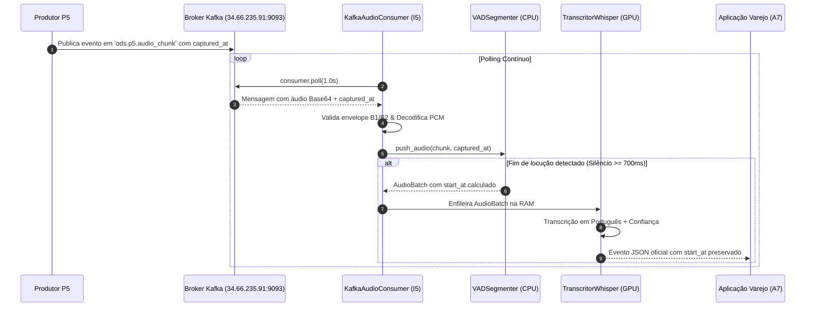

# Plano de Implementação: Consumidor Kafka de Áudio P5 (Componente I5)

Este documento descreve o plano de implementação para o card de integração do componente **I5** com o barramento de eventos **Kafka (B2)**, consumindo o fluxo contínuo de áudio proveniente do serviço **P5** (`ods.p5.audio_chunk`) e preservando a base de tempo (`captured_at`) para manter a sincronização com as câmeras de vídeo (B3).

---

## 1. Goal Description

Atualmente, o pipeline do **I5** executa fatiamento de áudio via VAD e transcrição Whisper consumindo arquivos estáticos de áudio (`.ogg`/`.wav`) ou simulações locais de microfone. 

O objetivo desta etapa é conectar o **I5** ao barramento Kafka oficial do projeto:
1. Conectar ao cluster Kafka no broker **`34.66.235.91:9093`** utilizando a biblioteca oficial **`confluent-kafka`**.
2. Subscrever o tópico **`ods.p5.audio_chunk`** com `group.id` exclusivo (ex: `i5-transcritor`).
3. Validar o envelope de mensagem conforme as regras da squad TRA-1 (B1/B2).
4. Extrair o timestamp **`captured_at`** de cada chunk de áudio e propagá-lo através do VAD para calcular o timestamp exato de início da fala (`start_at` / `timestamp_inicio`) na transcrição final, garantindo sincronia audiovisual com o componente B3.

---

## 2. User Review Required

> [!IMPORTANT]
> **Formato dos Dados de Áudio no Payload do P5:**
> Como o Kafka trafega mensagens de texto JSON estruturadas, os chunks de áudio de P5 trafegam no `payload` serializados em **Base64** (bytes PCM 16-bit ou float32). Implementaremos suporte automático para:
> * `payload["audio_data"]` ou `payload["audio_bytes"]` (string Base64 -> decodificado para NumPy float32).
> * `payload["sample_rate"]` (com reamostragem automática para 16.000 Hz caso o P5 transmita em 44.1/48 kHz).
> * Fallback se o áudio vier como lista numérica (`list[float]`).

> [!WARNING]
> **Consumo Responsável de Recursos no Broker (Google Cloud):**
> Conforme a seção 4.5 do Guia B2, loops de polling agressivos sem pausa consomem créditos de nuvem. O consumidor utilizará `poll(timeout=1.0)` com controle de reconexão e encerramento limpo via *graceful shutdown* (`SIGINT`/`SIGTERM`) fechando a conexão (`consumer.close()`).

---

## 3. Open Questions

> [!NOTE]
> 1. O produtor **P5** já está publicando ativamente no tópico `ods.p5.audio_chunk` no broker `34.66.235.91:9093`? Para fins de teste e desenvolvimento isolado, criaremos também um script mock (`src/mock_p5_producer.py`) que publica eventos de áudio com `captured_at` real, permitindo testes locais e no broker antes da integração final com a equipe de P5.

---

## 4. Proposed Changes

```
i5/
├── config/
│   └── pipeline_config.yaml         # [MODIFY] Adiciona seção 'kafka' (broker, tópico, group.id)
├── src/
│   ├── config_loader.py             # [MODIFY] Defaults e validação da seção 'kafka'
│   ├── kafka_audio_consumer.py      # [NEW] Consumidor Kafka com validação de envelope e extração de captured_at
│   ├── mock_p5_producer.py          # [NEW] Produtor mock para validação e testes de integração
│   ├── vad_segmenter.py             # [MODIFY] Suporte à ancoragem de timestamp captured_at por amostra
│   └── pipeline.py                  # [MODIFY] Flag --kafka para chavear entre arquivo e barramento Kafka
└── requirements.txt                 # [MODIFY] Adicionar confluent-kafka>=2.6.0
```

---

### Componente 1: Configuração e Dependências

#### [MODIFY] `requirements.txt`
Adiciona a biblioteca cliente oficial recomendada pelo Guia B2:
```text
confluent-kafka>=2.6.0
```

#### [MODIFY] `config/pipeline_config.yaml`
Adiciona a parametrização do Kafka no arquivo YAML já existente:
```yaml
# Conexão com o barramento Kafka (Transporte de Eventos B2)
kafka:
  bootstrap_servers: "34.66.235.91:9093" # Endereço do broker (Google Cloud / Local)
  group_id: "i5-transcritor"             # Identificador exclusivo do consumidor I5
  topic_input: "ods.p5.audio_chunk"      # Tópico de áudio contínuo emitido por P5
  auto_offset_reset: "latest"            # "latest" para tempo real, "earliest" para replay
  poll_timeout_s: 1.0                    # Timeout do poll em segundos
  enable_auto_commit: true               # Confirmação de offsets lidos
```

#### [MODIFY] `src/config_loader.py`
Incorpora os valores padrão da seção `kafka` no `DEFAULT_CONFIG`.

---

### Componente 2: Rastreamento Temporal no VAD (`captured_at` -> `start_at`)

#### [MODIFY] `src/vad_segmenter.py`
Para garantir que a base de tempo de P5 permaneça intacta:
1. `push_audio` passará a aceitar opcionalmente o timestamp da captura do bloco: `push_audio(audio_chunk: np.ndarray, captured_at: Optional[datetime.datetime] = None)`.
2. O `AudioBatch` registrará o timestamp absoluto inicial da fala calculado a partir do `captured_at` da amostra de ativação:
   $$\text{start\_at} = \text{captured\_at}_{\text{chunk}} + \Delta t_{\text{amostras}}$$
3. O metadado temporal é anexado diretamente ao lote de áudio emitido.

---

### Componente 3: Consumidor Kafka e Validador de Envelope

#### [NEW] `src/kafka_audio_consumer.py`
Implementa o consumidor Kafka baseado em `confluent_kafka.Consumer`:
* **Conexão:** Conecta a `34.66.235.91:9093` com `group.id: i5-transcritor`.
* **Subscrição:** Subscreve o tópico `ods.p5.audio_chunk`.
* **Validação (Seção 4.3 do Guia B2):**
  * Checagem de JSON válido.
  * Validação dos campos obrigatórios: `['message_id', 'message_type', 'schema', 'schema_version', 'producer', 'occurred_at', 'payload']`.
  * Validação do `schema == 'ods.p5.audio_chunk'` e versão compatível `1.x`.
* **Decodificação de Áudio:** Converte Base64/PCM para array NumPy float32 normalizado a 16kHz.
* **Extração de `captured_at`:**
  * Extrai `payload["captured_at"]` (ou `evento["occurred_at"]` como fallback seguro).
* **Integração com o Pipeline:** Entrega o chunk e o timestamp para a fila em memória do `RealtimeSpeechPipeline`.



---

### Componente 4: Produtor Mock para Validação

#### [NEW] `src/mock_p5_producer.py`
Script utilitário para testes de integração:
* Lê um arquivo de áudio local (`data/audio6.ogg`).
* Divide em fatias de 100ms e codifica em Base64.
* Monta o envelope canônico com `producer: "P5"`, `schema: "ods.p5.audio_chunk"` e `captured_at` em tempo real (ISO 8601 UTC).
* Publica no Kafka para validação do consumidor.

---

### Componente 5: Integração no Pipeline Principal

#### [MODIFY] `src/pipeline.py`
* Adiciona argumento `--kafka` no parser CLI.
* Se `--kafka` for acionado, instancia o `KafkaAudioConsumer` e escuta diretamente do broker do projeto até interrupção do usuário (`Ctrl+C`), salvando e logando as transcrições em tempo real com seus `start_at` sincronizados.

---

## 5. Verification Plan

### Testes Automatizados e Execuções

1. **Instalação e Verificação da Biblioteca:**
   ```bash
   pip install -r requirements.txt
   python3 -c "import confluent_kafka; print('Confluent Kafka OK:', confluent_kafka.__version__)"
   ```

2. **Teste de Validação de Envelope e Decodificação de Áudio (Testes Unitários):**
   * Criar teste que valida a rejeição de envelopes sem campos obrigatórios.
   * Validar decodificação correta de Base64 para NumPy float32.
   * Validar cálculo correto do `start_at` a partir do `captured_at`.

3. **Teste de Integração de Ponta a Ponta com o Broker:**
   * **Terminal 1:** Iniciar o consumidor I5 escutando o Kafka:
     ```bash
     python3 src/pipeline.py --kafka
     ```
   * **Terminal 2:** Disparar o produtor mock P5 transmitindo `data/audio6.ogg`:
     ```bash
     python3 src/mock_p5_producer.py --file data/audio6.ogg
     ```
   * **Critério de Sucesso:** O consumidor no Terminal 1 deve:
     * Receber os chunks do broker `34.66.235.91:9093`.
     * Detectar a fala e transcrever em português.
     * Exibir o `start_at` idêntico ao `captured_at` emitido pelo P5.
     * Salvar os JSONs em `jsons_gerados/` no formato canônico.

### Verificação Manual pelo Usuário
* O usuário poderá conferir o arquivo gerado em `jsons_gerados/` e atestar que o campo `"timestamp_inicio"` reflete exatamente a base de tempo de captura do P5.

